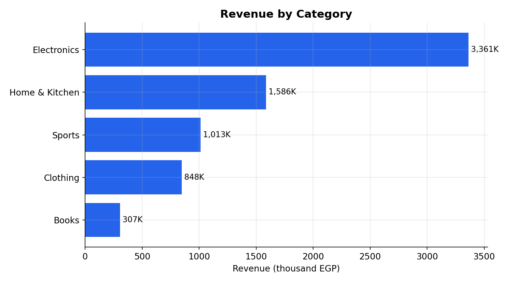
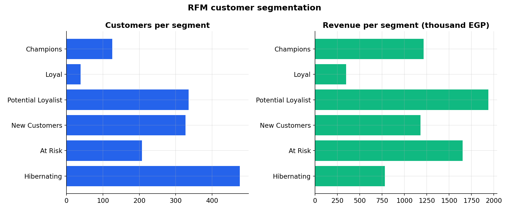
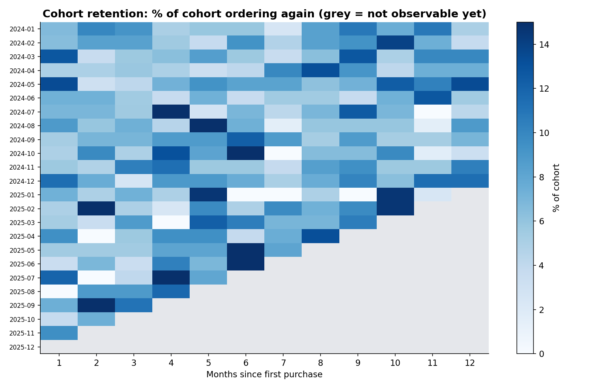

# Sales Data Analysis

  

**Live explorer:** https://hassan3443.github.io/sales-data-analysis/ (filters, a tested forecast, cohort heatmap, RFM, Pareto)

Exploratory data analysis of two years of retail sales (3,269 orders) using Python, Pandas and Matplotlib: revenue trends, category and region performance, payment behavior and customer repeat rates, plus customer-level analytics (RFM segmentation, cohort retention and revenue concentration), ending in written business takeaways.

## Key findings

- **Total revenue:** 7.1M EGP across 3,269 orders (1,510 unique customers, 2024-2025)
- **Electronics** drives 47.2% of revenue; **Cairo** contributes 39.4%
- Revenue is **seasonal**: peaks around spring and year-end (December 2025 was the best month)
- **Credit Card** is the leading payment method (35.5% of revenue)
- **66% repeat customer rate**, so re-engaging one-time buyers is the cheapest growth lever

- **Revenue is concentrated:** the top 20% of customers generate 53% of revenue
- **RFM segmentation:** 126 Champions (8% of customers) bring 17% of revenue; 207 At Risk customers hold 23% of revenue and are the best win-back target
- **Retention is thin:** only about 7% of a monthly cohort orders again one month after the first purchase

Full write-ups: [reports/key_insights.md](reports/key_insights.md) and [reports/customer_insights.md](reports/customer_insights.md).

## Forecast, with a backtest

`src/forecast.py` compares four simple models on monthly revenue, all in numpy: naive (last month), mean of the last 3 months, seasonal naive (same month last year), and a linear trend plus a fixed effect per calendar month. Two scoring methods are used, and they disagree, which is the honest finding with only 24 months of data:

| Model | Rolling origin (10 origins, 3 months ahead) | Single hold-out (last 6 months) |
| --- | ---: | ---: |
| seasonal naive | 12.2% | 16.1% |
| trend + month effects | 18.6% | 21.4% |
| mean of last 3 | 18.9% | 14.6% |
| naive | 22.5% | 24.4% |

Numbers are mean absolute percentage error (MAPE), from `python src/site_data.py`. The model with 13 parameters fitted to 12 to 23 points does worse than the simple seasonal rule, a small example of overfitting. The explorer shows the best rolling model's forecast for Jan to Mar 2026 as a baseline, not a prediction. The data is synthetic, so this demonstrates the method, not real demand.

## Visualizations

### Monthly Revenue Trend


### Revenue by Category


### Revenue by Region


### Payment Method Share


### RFM Customer Segments


### Cohort Retention


### Revenue Concentration


## Project structure

```
sales-data-analysis/
├── data/sales_data.csv          # dataset (synthetic, reproducible)
├── figures/                     # charts produced by the analysis
├── reports/key_insights.md      # written findings and takeaways
├── src/
│   ├── generate_sales_data.py   # regenerates the dataset (fixed seed)
│   ├── analyze_sales.py         # revenue, category, region, payment analysis
│   ├── customer_analysis.py     # RFM segments, cohort retention, Pareto
│   ├── forecast.py              # four forecast models, hold-out and rolling backtests
│   └── site_data.py             # computes everything for the live explorer (docs/data.json)
├── docs/                        # live explorer (static page)
├── tests/                       # pytest (customer analysis, forecast, site data) + node test for the filter code
└── requirements.txt
```

## Run it

```bash
pip install -r requirements.txt
python src/generate_sales_data.py   # optional: dataset is included
python src/analyze_sales.py
python src/customer_analysis.py   # RFM, cohorts, Pareto
python src/site_data.py           # refresh docs/data.json for the live explorer
python -m pytest tests -q          # forecast, site data and customer analysis tests
node --test tests/js/agg.test.js   # explorer filtering matches pandas totals
```

Charts land in `figures/` and the written summary in `reports/key_insights.md`.

## Analysis questions answered

- How does revenue trend month over month, and how seasonal is it?
- Which categories and regions generate the most revenue?
- How do customers prefer to pay?
- What does the average order look like, and how loyal are customers?
- Which customers are Champions, which are At Risk, and who is worth a win-back offer?
- How quickly do new customers come back, and how concentrated is revenue?

## Tools

Python, Pandas, NumPy, Matplotlib, pytest

## Note on the data

The dataset is synthetic, generated by `src/generate_sales_data.py` with a fixed random seed and realistic seasonality, regional weights and price ranges. Swap `data/sales_data.csv` for a real export with the same columns and the analysis runs unchanged.

## Author

Hassan Ashraf - [github.com/Hassan3443](https://github.com/Hassan3443)
