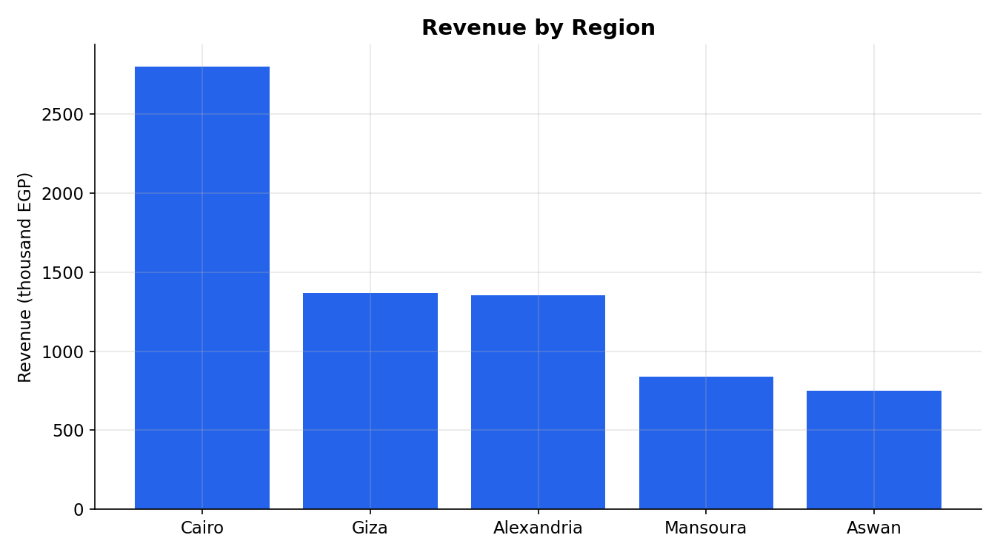

# Sales Data Analysis

Exploratory data analysis of two years of retail sales (3,269 orders) using Python, Pandas and Matplotlib: revenue trends, category and region performance, payment behavior and customer repeat rates, ending in a written set of business takeaways.

## Key findings

- **Total revenue:** 7.1M EGP across 3,269 orders (1,510 unique customers, 2024-2025)
- **Electronics** drives 47.2% of revenue; **Cairo** contributes 39.4%
- Revenue is **seasonal**: peaks around spring and year-end (December 2025 was the best month)
- **Credit Card** is the leading payment method (35.5% of revenue)
- **66% repeat customer rate**, so re-engaging one-time buyers is the cheapest growth lever

Full write-up in [reports/key_insights.md](reports/key_insights.md).

## Visualizations

### Monthly Revenue Trend


### Revenue by Category


### Revenue by Region


### Payment Method Share


## Project structure

```
sales-data-analysis/
├── data/sales_data.csv          # dataset (synthetic, reproducible)
├── figures/                     # charts produced by the analysis
├── reports/key_insights.md      # written findings and takeaways
├── src/
│   ├── generate_sales_data.py   # regenerates the dataset (fixed seed)
│   └── analyze_sales.py         # the analysis: charts + insights
└── requirements.txt
```

## Run it

```bash
pip install -r requirements.txt
python src/generate_sales_data.py   # optional: dataset is included
python src/analyze_sales.py
```

Charts land in `figures/` and the written summary in `reports/key_insights.md`.

## Analysis questions answered

- How does revenue trend month over month, and how seasonal is it?
- Which categories and regions generate the most revenue?
- How do customers prefer to pay?
- What does the average order look like, and how loyal are customers?

## Tools

Python, Pandas, Matplotlib

## Note on the data

The dataset is synthetic, generated by `src/generate_sales_data.py` with a fixed random seed and realistic seasonality, regional weights and price ranges. Swap `data/sales_data.csv` for a real export with the same columns and the analysis runs unchanged.

## Author

Hassan Ashraf - [github.com/Hassan3443](https://github.com/Hassan3443)
